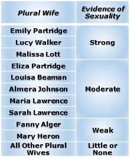
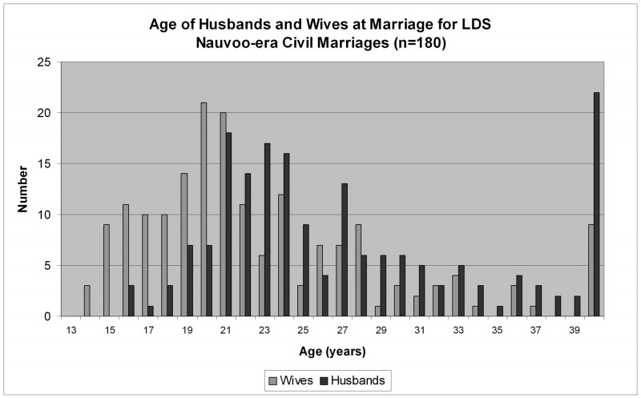

# Did plural marriages include sexual relations?

Source: [Joseph Smith's Polygamy, "Did Plural Marriages Include Sexual
Relations?"](https://josephsmithspolygamy.org/common-questions/plural-marriages-sexual/)
(Brian Hales's research site). Companion file to
`joseph-smith-s-polygamy.md` and `teenage-plural-wives.md` — this file
covers the pattern across all ~30-40 sealings, not just the youngest
wives.

## General response

LDS plural sealings were of two distinct types: "time-and-eternity"
(could include sexual relations in mortality) and "eternity-only" (no
mortal intimacy intended). State this distinction up front — it's the
reason "did Joseph have sex with his plural wives" doesn't have a single
yes/no answer across all ~30-40 sealings. The source's own summary:
"evidence indicates that less than half of Joseph Smith's polygamous
unions were consummated and sexual relations in the others occurred
infrequently." No documented evidence of sexual relations exists for
three specific subgroups: the 14-year-old wives (see
`teenage-plural-wives.md`), women to whom Joseph was not actually
married ("non-wives"), and women who were legally married to and having
conjugal relations with a civil husband at the time of their sealing to
Joseph.

Chart summarizing which wives have documented evidence of sexual
relations:

## Catholic and Protestant response

The specific documentary evidence for sexual relations is direct
testimony, not inference, for at least nine wives — cite specific
examples rather than a vague "some wives" claim:

- **Emily Partridge**, under oath in the 1892 Temple Lot deposition,
  asked directly if she ever slept with Joseph Smith "in the same bed,"
  answered "Yes sir."
- **Lucy Walker** reportedly told her niece she "lived with Joseph Smith
  as a wife" (reported secondhand to Joseph Smith III, 1876).
- **Malissa Lott**, asked directly by Joseph Smith III in an 1893
  interview if she was the Prophet's "wife in very deed," answered "Yes."
- **Maria Lawrence**: William Law (an apostate critic, not a
  sympathetic source) formally charged Joseph Smith in a Carthage court
  with living "in an open state of adultery" with her in May 1844 — a
  hostile-witness legal filing, useful evidentially precisely because
  it's adversarial.
- **Fanny Alger**: multiple secondhand accounts describe Emma Smith
  personally witnessing Joseph and Fanny together, and one source claims
  she became pregnant.

Weigh evidence quality explicitly on screen rather than treating all
nine-plus cases as equally certain — sworn Temple Lot deposition
testimony (Partridge, Lott) is stronger evidence than a secondhand report
of what someone allegedly said to a niece (Walker), and the source itself
flags three additional cases (Eliza R. Snow, Sarah Ann Whitney, Hannah
Ells) as having real credibility problems or contradictory evidence —
don't cite those three with the same confidence as the first group.

## Exmo/atheist response

Engage the fertility argument directly, since it's the strongest
circumstantial evidence on either side of the frequency question: no
children are confirmed to have been born to Joseph Smith and any plural
wife, despite Joseph having fathered nine children with Emma (proving he
was fertile) and several plural wives going on to have multiple children
quickly after remarrying following his death (Sarah Ann Whitney and Lucy
Walker each conceived within about three months of remarrying Heber C.
Kimball in early 1845; Malissa Lott conceived roughly 11 weeks after
remarrying in 1849). Lay out both sides of the inference rather than
picking one: either sexual relations with Joseph were genuinely
infrequent/limited to a minority of the sealings (consistent with the
"less than half consummated" claim above), or children were conceived and
the paternity was successfully concealed — the source argues concealment
is unlikely because RLDS succession disputes in the 1860s-70s would have
given LDS leadership a live institutional motive to publicly identify any
of Joseph's biological children, and none were ever produced.

Practical constraints on frequency are also worth naming plainly rather
than assuming unlimited opportunity: Joseph's full civic/ecclesiastical
schedule as Church president and Nauvoo mayor, periods in hiding from
Missouri lawmen, the need for continued secrecy even from most members
after John C. Bennett's 1842 public accusations, and Emma Smith's active,
documented efforts (including reportedly assigning people to monitor him)
to prevent private time between Joseph and his plural wives after July
1843 — all cut against frequent opportunity, independent of any
theological argument.

Nauvoo-era context chart (civil marriage ages, showing marriages in the
15-20 range were not unusual generally) — relevant to
`teenage-plural-wives.md`'s "not unusual for the era" argument as well:

**Certainty level:** that some plural marriages were consummated is
`fact` (sworn testimony exists); the overall proportion and frequency
across all ~30-40 sealings is `disputed`/inferential, resting on
fertility patterns and circumstantial reasoning rather than direct
testimony for most individual cases — present the summary claim
("less than half") as the source's own estimate, not an established
count.
