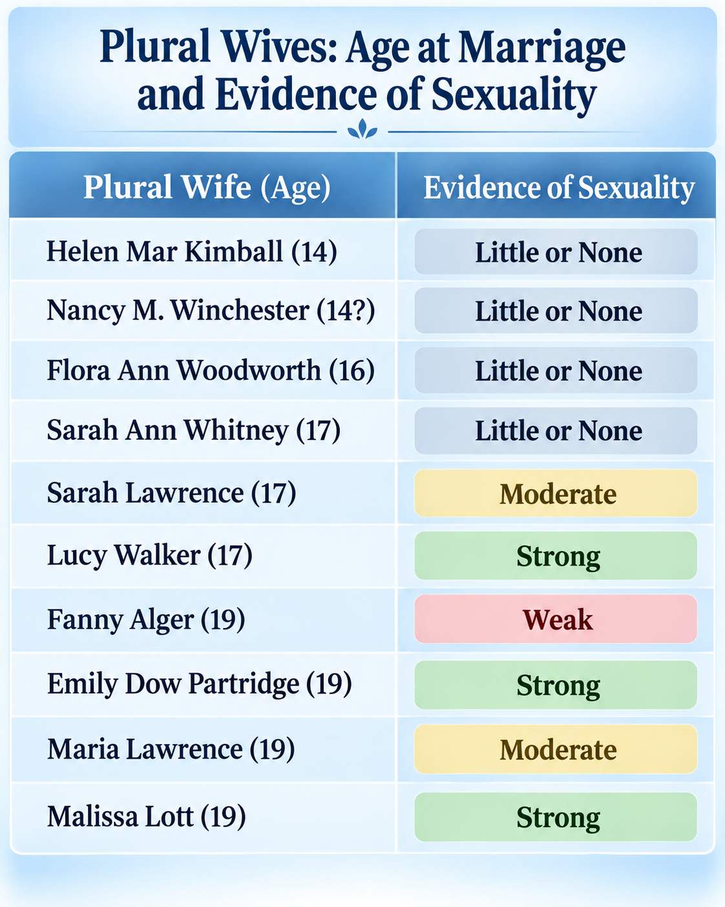

# Teenage plural wives

## General response

Joseph Smith married at least one wife, Helen Mar Kimball, at age 14 (he
was 37); several other plural wives were in their teens or early
twenties. This is documented and not seriously disputed by faithful LDS
historians — state it plainly and immediately rather than working up to
it.

## Added 2026-09-12 — the full list, and what's actually documented for the two 14-year-olds

Source: [Joseph Smith's Polygamy, "Sealings to Young Brides"](https://josephsmithspolygamy.org/common-questions/14-year-old-wives-teenage-brides/)
(Brian Hales's research site; essay by Gregory L. Smith). Give the full
list rather than only citing Helen Mar Kimball, since "married a
14-year-old" understates how many marriages were to teenagers and
overstates how typical fourteen specifically was — ten of Joseph Smith's
plural wives were under twenty at sealing:

| Wife | Age at sealing |
|---|---|
| Helen Mar Kimball | 14 |
| Nancy M. Winchester | 14 (uncertain) |
| Flora Ann Woodworth | 16 |
| Sarah Ann Whitney | 17 |
| Sarah Lawrence | 17 |
| Lucy Walker | 17 |
| Fanny Alger | 19 |
| Emily Dow Partridge | 19 |
| Maria Lawrence | 19 |
| Malissa Lott | 19 |

**The specific, narrower claim worth being precise about on screen:**
sexual relations are documented for several of the seven older plural
wives (ages 16-19), but *no documentation supports consummation* for
either of the two 14-year-old sealings (Helen Mar Kimball, Nancy
Winchester) — this is a materially different evidentiary claim than "no
consummation happened," and both halves should be stated precisely
rather than collapsed into either "it was definitely never consummated"
or "the ages don't matter, they're all the same category."

Supporting detail for the Helen Mar Kimball case specifically:

- Her father, Heber C. Kimball, initiated the sealing — Helen herself
  wrote "he offered me to him; this I afterward learned from the
  Prophet's own mouth," describing the marriage as arranged by her
  father rather than proposed by Joseph.
- Michael Marquardt (a non-apologetic historian) describes it as "a
  spiritual [sealing] unlike other wives who had sexual relations with
  the prophet" — cited because a critical historian making this
  assessment is a stronger citation than a faithful source making the
  same claim.
- Helen's own 1881 poem and 1882 *Woman's Exponent* reminiscence
  describe ongoing longing for normal teenage social life (dances,
  friends) after the sealing, in terms most naturally read as describing
  someone who did not yet consider herself functioning as a wife — a
  textual argument, not direct testimony, and should be presented with
  that qualification.
- In the 1892 RLDS v. Church of Christ (Temple Lot) case, three plural
  wives (Lucy Walker, Emily Partridge, Malissa Lott) were deposed and
  each affirmed sexual relations with Joseph Smith; Helen — geographically
  closer to the trial than two of the three who did testify — was not
  called. Absence of testimony is not positive evidence of non-
  consummation (it's an argument from silence), but it is consistent
  with it, and Brigham Young's later instruction that Utah polygamous men
  wait until plural brides turned at least eighteen to consummate a
  sealing plausibly reflects a policy that "began in Nauvoo with Joseph
  Smith" — state this as the source's own inference, not an established
  fact.

For Nancy Winchester specifically: even less is documented — no sealing
date survives, her age (14 or 15) is inferred rather than recorded
directly, and the evidence she was sealed to Joseph Smith at all rests on
two secondhand sources (Eliza R. Snow via Andrew Jenson's 1886-87 notes,
and Orson F. Whitney's 1888 biography of his father Heber C. Kimball).
Treat her case as `disputed` at the level of whether the sealing
happened at all, one level more uncertain than Helen Mar Kimball's case.

## Catholic and Protestant response

Engage the actual ethical weight of this directly rather than only citing
that such marriage ages were not unusual by 1840s American legal/social
norms (which is true but insufficient alone as a full moral response) —
a more honest response distinguishes *legality/social normalcy at the
time* from *moral defensibility*, and should not lean on the first to
fully answer the second.

## Exmo/atheist response

Give the direct, unminimized picture, since minimizing here is the single
most credibility-damaging move available on this topic:

- Helen Mar Kimball herself, years later, described entering the
  marriage under significant family and religious pressure and
  expressed real ambivalence and pain about the experience in her later
  writings — this is a primary-source account worth citing directly
  rather than only citing secondary summaries.
- A specific academic argument worth citing carefully: "The Age of
  Joseph Smith's Plural Wives in Social and Demographic Context"
  (cited in Interpreter,
  [3_Interpreter_PDF, p. 239](https://corpus.noahairmet.com/b/3-interpreter-pdf-9eb2/239))
  argues the age range, while young by modern standards, was within the
  range of legally and socially recognized marriage ages in 1840s
  America. Present this as contextualizing, not justifying — state the
  historical context and the limits of what it shows in the same beat
  (`research-protocol.md` sec 7's "true but out of context" pattern
  applies precisely here): the historical context is real, and it does
  not by itself make the practice ethically unproblematic by any standard,
  including many standards already present in the 1840s (critics at the
  time, including some of Joseph Smith's own associates, objected on
  exactly these grounds).

Do not attempt to fully resolve this one on screen — this is a case
where naming the difficulty honestly and refusing to minimize it is
itself the more credible and more defensible response than any confident
resolution would be.

Chart specifically relating wife's age at sealing to likelihood of
sexual relations having occurred (use this one for the age-specific
question; `plural-marriage-sexual-relations.md`'s chart covers *how many*
wives overall had documented sexual relations, not broken out by age):

See `plural-marriage-sexual-relations.md` for the broader evidentiary
picture across all of Joseph Smith's plural wives (not just the two
14-year-olds), including the fertility-pattern argument and the
full-list sourced chart.
